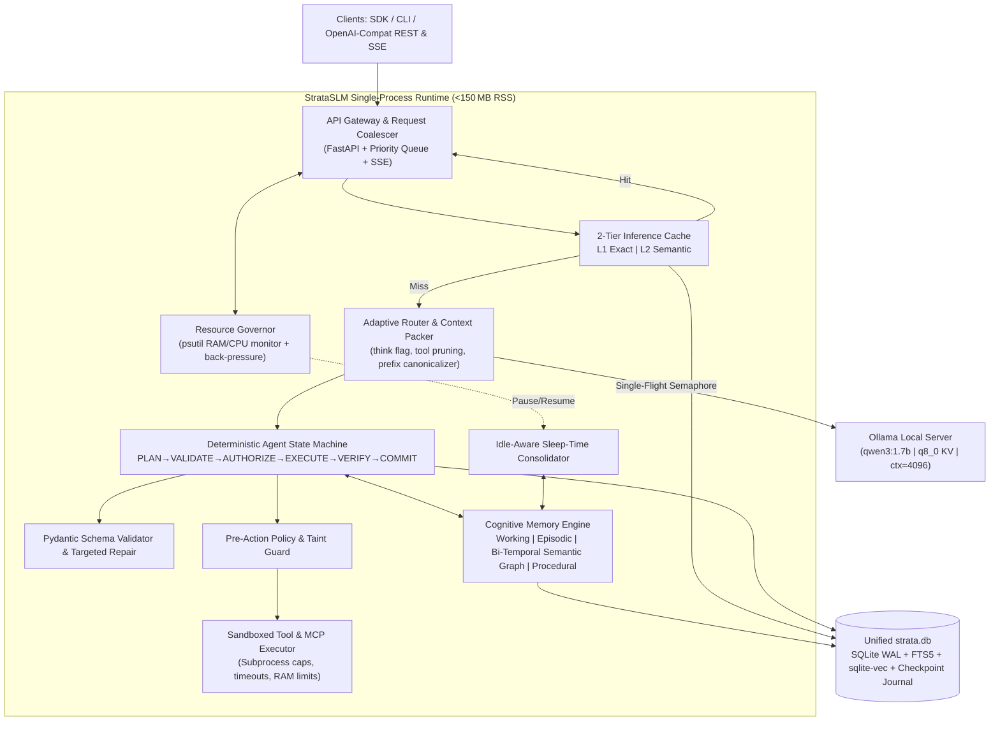

# StrataSLM – Project Master Plan

> **Tagline:** *System Intelligence Over Model Scale – a featherweight, deterministic local AI runtime & cognitive memory engine for an 8 GB CPU‑only laptop.*

## Unique Project Title Options
- **StrataSLM** – emphasizes a layered system architecture that extracts intelligence from Small Language Models (SLM). *(recommended)*
- **CogStrata** – highlights the cognitive‑memory focus.
- **IronLattice** – conveys deterministic safety and lightweight resilience.

---

## 1. Executive Vision & Core Philosophy
Modern AI frameworks assume massive cloud GPUs and multi‑gigabyte models. **StrataSLM** flips that assumption: on an **8 GB RAM, Intel i5‑only laptop**, we achieve high‑performance, reliable agents by moving intelligence from the model weights into a carefully engineered system layer:
1. **Inference Speed without bigger hardware** – KV‑cache‑aware prompt prefixes, dual‑layer exact + semantic caching, and a `think` toggle (`false` for fast routes, `true` for deep reasoning).
2. **Reliability without larger models** – deterministic state‑machine orchestration, schema‑guarded JSON repair, capability‑tagged sandboxing, and durable SQLite checkpointing.
3. **Lightweight Local AI Infrastructure** – a single‑process Python runtime exposing OpenAI‑compatible REST/SSE endpoints, a tidy SDK, and a plugin/MCP ecosystem.
4. **True Long‑Term Memory** – a hybrid SQLite engine (WAL + FTS5 + sqlite‑vec + bi‑temporal graph) that consolidates facts during idle time.
5. **Continuous Performance Engineering** – built‑in RAM/CPU governors, profiling suites, and regression‑tested benchmarks.

---

## 2. Target Hardware Profile & Hard Limits (8 GB RAM)
| Component | Target RSS | Hard Ceiling | Design Strategy |
|---|---:|---:|---|
| Windows OS + Terminal/Editor | ~3.2–3.8 GB | ~4.2 GB | Keep dev stack light (no Docker, no heavy browsers). |
| Ollama Server + Primary LLM (`qwen3:1.7b`) | **~1.8–2.1 GB** | **2.4 GB** | `Q4_K_M` weights (~1.4 GB) + `num_ctx=4096` + `OLLAMA_KV_CACHE_TYPE=q8_0`. |
| StrataSLM Runtime + FastAPI | ~80–130 MB | 180 MB | Single‑process async Python, lazy imports, zero PyTorch. |
| In‑process Micro‑Embedder (`all‑MiniLM‑L6‑v2` ONNX) | ~90–120 MB | 150 MB | Quantised ONNX Runtime on CPU, no separate embedding model in Ollama. |
| SQLite Memory & Cache (WAL + FTS5 + sqlite‑vec) | ~20–60 MB | 100 MB | Memory‑mapped DB with bounded LRU cache. |
| Sandboxed Tool Subprocess (on‑demand) | ~30–80 MB | 128 MB | Per‑tool caps, timeouts, auto‑reap. |
| **Total AI Stack** | **~2.0–2.5 GB** | **~3.0 GB** | Leaves ~1‑1.5 GB OS safety buffer.

**Non‑Negotiable Rules**
1. No Docker, Redis, PostgreSQL, Neo4j, Qdrant, or PyTorch.
2. `OLLAMA_MAX_LOADED_MODELS=1` & `OLLAMA_NUM_PARALLEL=1`.
3. Pin CPU threads to 4‑6 physical P‑cores.
4. Context windows ≤ 4096 tokens (optional 2048 ultra‑fast mode).
5. Active resource governor pauses background jobs when free RAM < 1.2 GB or CPU > 80 %.

---

## 3. Architectural Decision Record (ADR) Log
| ADR # | Decision | Status | Rationale |
|---|---|---|---|
| ADR‑001 | Use **Ollama + `qwen3:1.7b`** as primary model | ✅ Adopted | Fits RAM budget, offers tool‑call restraint, and supports `think` toggle. |
| ADR‑002 | Load **embeddings in‑process via ONNX** | ✅ Adopted | Avoids Ollama model‑swap thrashing and stays under 100 MB. |
| ADR‑003 | **Single‑process modular monolith** (Python 3.12) | ✅ Adopted | Minimal process overhead, easy to profile, fits Windows sandbox. |
| ADR‑004 | **SQLite WAL** as unified persistence layer | ✅ Adopted | Atomic checkpointing, low RAM, no external DB server. |
| ADR‑005 | **2‑Tier Cache (Exact + Semantic)** | ✅ Adopted | Guarantees sub‑ms L1 hits; semantic fallback saves compute. |
| ADR‑006 | **Deterministic state‑machine for agents** | ✅ Adopted | Prevents infinite loops on small models; improves `pass^k`. |
| ADR‑007 | **Resource Governor with 3‑stage thresholds** | ✅ Adopted | Guarantees OOM‑free operation on 8 GB laptop. |
| ADR‑008 | **Idle‑aware Sleep‑Time Consolidator** | ✅ Adopted | Moves heavy memory grooming to idle cycles, preserving latency. |

---

## 4. Research Landscape (2024‑2026)
Before designing StrataSLM, we surveyed leading open-source frameworks and recent peer-reviewed / arXiv research across inference efficiency, agent reliability, security, and long-term memory.

### 4.1 Related Open-Source Projects Analyzed

| Project | Domain | Strengths | Why Not Use As-Is on 8GB CPU? | What StrataSLM Adapts |
|---|---|---|---|---|
| **Ollama / `llama.cpp`** | Local LLM engine | GGUF Q4 quantization, KV quantization (`q8_0`/`q4_0`), Flash Attention, prefix reuse, native tool templates | Provides raw inference only; no durable agent state, semantic cache, policy guardrails, or long-term memory | Core inference backend controlled via tuned `Modelfile`s, `/api/chat` options, and `think` toggling |
| **SGLang (RadixAttention)** | Inference serving | Prefix-tree KV reuse across shared prompts & multi-turn agent histories | GPU/CUDA server oriented; heavy footprint for CPU laptops | **Prefix-Canonical Prompt Layout** (immutable system/tool prefix ordering) to maximize Ollama's native prefix cache hit rate |
| **GPTCache** | Semantic caching | Vector similarity lookup avoids repeated LLM generation | Requires extra heavy dependencies / external vector stores for production setups | Lightweight **2-Tier Cache** (exact normalized hash + `sqlite-vec` semantic threshold + tool-schema version tag) |
| **RouteLLM** | Model routing | Routes simple vs hard prompts across model tiers | Focused on cloud strong/weak pairs | **Hybrid Complexity & Mode Router** (`think=False` vs `think=True` on `qwen3:1.7b`, or escalating `0.6b → 1.7b → 4b`) |
| **PydanticAI / LangGraph** | Agent orchestration | Typed schema validation (`PydanticAI`), explicit state graphs (`LangGraph`) | LangGraph ecosystem drags in heavy abstractions; small 1.7B–3B models still fail loops without deterministic repair/policies | Compact **Deterministic State Machine** + **Pydantic Schema Repair Loop** with zero framework bloat |
| **DBOS / Temporal** | Durable execution | Crash-resistant step journals & idempotent workflow replay | Temporal requires multi-container infrastructure | **SQLite-backed Durable Execution Journal** (idempotency keys + step checkpoints + resume after crash) |
| **Letta (MemGPT) / Mem0 / Zep (Graphiti)** | Agent memory | Tiered paging (Letta), fact extraction (Mem0), bi-temporal graphs (Graphiti) | Often assume cloud LLM extraction loops or heavy graph DBs (Neo4j) | **Embedded CoALA-inspired 3-Tier SQLite Memory** with bi-temporal fact invalidation (`valid_from` / `invalid_at`) and idle-only consolidation |

### 4.2 Recent Research Papers & Ideas Adapted

1. **Inference Speed, KV Cache & Prompt Optimization**
   - ***SGLang: Efficient Execution of Structured Language Model Programs*** (`arXiv:2312.07104`) — Demonstrates massive throughput gains from **RadixAttention** prefix reuse. *Adaptation:* Canonicalize system prompts, memory blocks, and tool schemas so static tokens sit strictly at index `0..k`, ensuring Ollama reuses KV prefill across agent turns.
   - ***KVSET*** (Sept 2026) & ***CompressKV*** (June 2026) & ***VerKV*** (Nov 2026) — Show that KV cache working sets can be bounded and semantically pruned rather than blindly holding full uncompressed history. *Adaptation:* **Budgeted Context Packer** that allocates fixed token slices (System Prefix / Retrieved Facts / Recent Episodic Turns / Tool Observations) and compacts stale observations cleanly before hitting `num_ctx`.
   - ***LLMLingua* (`arXiv:2310.05736`) & *LLMLingua-2* (`arXiv:2403.12968`)** — Proves prompts contain high redundancy that degrades latency. *Adaptation:* Instead of running a second neural compressor in 8GB RAM, implement **Zero-LLM Structural Prompt Compression** (dynamic tool-schema filtering—injecting only top-$k$ relevant tools—plus whitespace/boilerplate/JSON-observation truncation).
   - ***RouteLLM*** (`arXiv:2406.18665`) — Dynamic difficulty routing cuts compute dramatically. *Adaptation:* Route trivial queries to exact/semantic cache or `think=False`, and reserve `think=True` (or `qwen3:4b`) strictly for multi-step planning and failure recovery.

2. **Reliable, Secure & Deterministic AI Agents**
   - ***CaMeL: Defeating Prompt Injections by Design*** (Debenedetti et al., Google / Google DeepMind / ETH Zurich, `arXiv:2503.18813`) — Proves small/aligned models cannot defend against indirect prompt injection via weights alone; control flow must be separated from untrusted data flow with capability tracking. *Adaptation:* **Taint-Tagged Data & Capability Guard**—external tool outputs (files, web pages, DB rows) are marked `UNTRUSTED` and cannot dynamically unlock privileged tools (shell, write, network) without explicit capability policy approval.
   - ***AgentSpec: Customizable Runtime Enforcement for Safe and Reliable LLM Agents*** (Wang, Poskitt, Sun; `arXiv:2503.18666`, ICSE 2026) — Introduces lightweight `Trigger → Predicate → Enforcement` rules (`stop`, `user_inspection`, `invoke_action`, `llm_self_examine`). *Adaptation:* Synchronous **Pre-Action Policy Interceptor** before every tool execution.
   - ***TAU-bench* ($\tau$-bench `pass^k`) & *ToolSandbox* & *BFCL*** — Establish that single-run `pass@1` hides severe multi-turn unreliability; production agents must be measured by multi-trial consistency (`pass^k`) and stateful dependency tracking.

3. **Long-Term Agent Memory & Cognitive Architectures**
   - ***CoALA: Cognitive Architectures for Language Agents*** (Sumers et al., Princeton) — Separates **Working Memory**, **Episodic**, **Semantic**, and **Procedural** memory with explicit internal/external actions. *Adaptation:* StrataSLM explicitly implements all four memory types, including a **Procedural Skill Macro Cache** that replays verified tool sequences deterministically.
   - ***Zep: A Temporal Knowledge Graph Architecture for Agent Memory*** (`arXiv:2501.13956`, Graphiti) — Solves the stale-fact problem via **bi-temporal modeling** and contradiction invalidation. *Adaptation:* SQLite entity-relation edges carry `created_at`, `valid_from`, and `invalid_at` timestamps so updated user facts invalidate superseded facts cleanly.
   - ***A-MEM: Agentic Memory for LLM Agents*** (`arXiv:2502.12110`) — Zettelkasten-inspired atomic notes with dynamic cross-linking and memory evolution. *Adaptation:* Atomic memory notes with tags, summaries, and lightweight semantic neighbor links in SQLite.
   - ***Mem0: Building Production-Ready AI Agents with Scalable Long-Term Memory*** (`arXiv:2504.19413`) — Selective `ADD / UPDATE / DELETE / NOOP` fact consolidation. *Adaptation:* Rule-first + SLM-assisted memory mutation pipeline to prevent unbounded DB bloat.
   - ***Sleep-time Compute: Beyond Inference Scaling at Test-time*** (Lin et al., Letta, `arXiv:2504.13171`) — Offloads memory compression, graph linking, and anticipatory synthesis from test-time to idle cycles. *Adaptation:* **Idle-Aware Sleep-Time Consolidator** that runs only when user queues are empty and RAM/CPU headroom is safe.
   - ***LoCoMo* (`arXiv:2402.17753`) & *LongMemEval* (`arXiv:2410.10813`)** — Standard benchmarks testing multi-session reasoning, temporal reasoning, knowledge updates, and abstention.

---

## 5. Model & Embedding Selection (Ollama)
| Model Tag | Size | Peak RSS | Tokens / s | Verdict |
|---|---|---|---|---|
| **`qwen3:1.7b`** | ~1.4 GB | ~1.8‑2.1 GB | 20‑40 | **PRIMARY** – best RAM safety, speed, tool restraint, `think` toggle. |
| `qwen3:0.6b` | ~523 MB | ~0.9‑1.1 GB | 45‑75 | **FAST ROUTER** – for complexity classification & baseline. |
| `qwen3:4b` | ~2.5 GB | ~3.2‑3.6 GB | 10‑18 | **HIGH‑ACCURACY** – optional when laptop is idle. |
| `llama3.2:3b` | ~2.0 GB | ~2.6‑3.1 GB | 14‑25 | **STRESS TEST** – validates policy & guardrails. |
| `phi4-mini` (3.8B) | ~2.5 GB | ~3.5‑4.3 GB | 10‑16 | **REASONING COMP** – for comparative studies.

**Embedding** – `all‑MiniLM‑L6‑v2` (ONNX, ~90 MB) for fast CPU similarity; optional Ollama `all‑minilm` for offline batch indexing.

---

## 6. High‑Level System Architecture

**Key Principles**
- **Prefix‑First Canonical Prompting** – static system & tool tokens occupy leading positions, maximising KV reuse.
- **Unified SQLite DB** – execution checkpoints, caches, episodic logs, and bi‑temporal facts live together.
- **Single‑Flight Multiplexing** – serialises Ollama calls while co‑alescing identical in‑flight requests.

---

## 7. Pillar‑wise Deep‑Dive & Deliverables
### Pillar 1 – Inference Speed & CPU Optimisation
- Prefix‑canonical prompt engine (≥ 70 % KV reuse).
- Dynamic top‑k tool‑schema pruning (‑50 %‑80 % pre‑fill tokens).
- 2‑Tier cache with sub‑ms L1 hits.
- Adaptive `think` routing.
- **Deliverables:** `strata_inference` engine, benchmark report, CPU/Flamegraph profiling.

### Pillar 2 – Reliable AI Agents
- Deterministic state‑machine with loop guards.
- Schema‑constrained parsing + deterministic JSON sanitizer.
- Pre‑action policy DSL (`AgentSpec`‑style) & taint tracking (`CaMeL`).
- Capability‑capped sandbox with Windows Job Objects.
- Durable SQLite step journal & Saga‑style rollback.
- Procedural skill distillation.
- **Deliverables:** `strata_agents` library, architecture docs, fault‑injection test suite, `pass^k` reliability benchmarks.

### Pillar 3 – AI Infrastructure (Runtime, SDK, APIs & Plugins)
- OpenAI‑compatible FastAPI gateway (`/v1/chat/completions`, `/v1/runs`).
- Python SDK (`StrataClient`, `@tool`).
- Plugin/MCP manifest loader.
- CLI (`strata doctor|serve|run|bench|profile`).
- Sample apps: Workspace Analyst, Ops Helper, Memory Companion.
- **Deliverables:** `strata_server`, `strata_sdk`, plugin system, documentation.

### Pillar 4 – Cognitive Long‑Term Memory
- CoALA‑inspired 4‑part SQLite memory (working, episodic, semantic, procedural).
- Bi‑temporal fact graph with `valid_from/invalid_at` timestamps.
- Hybrid RRF (BM25 + sqlite‑vec) retrieval.
- Idle‑aware consolidation worker.
- Evaluation harness against LongMemEval & LoCoMo.
- **Deliverables:** `strata_memory` library, benchmark suite, <150 MB memory footprint report.

### Pillar 5 – Continuous Performance Engineering & Observability
- Lazy‑import startup < 300 ms; API ready < 800 ms.
- 3‑stage resource governor (green/yellow/red).
- Async request scheduler with coalescing & priority lanes.
- `strata_perf` regression harness (cold‑start, TTFT, throughput, RSS, cache‑hit speed‑up, concurrency).
- **Deliverables:** Telemetry instrumentation, regression test suite, final performance report.

---

## 8. Benchmark & Evaluation Plan
| Suite | Measures | Baselines | Targets |
|---|---|---|---|
| CPU Inference & Cache | Startup, TTFT, `tok/s`, RSS, cache hit speed‑up | Raw Ollama uncached | ≥ 2× faster TTFT, < 15 ms L1 hit, ≤ 2.4 GB RSS |
| Agent Reliability | Schema validity, `pass^k`, injection block, crash recovery | Naïve ReAct | ≥ 95 % JSON validity, > 20 % `pass^3` gain, 100 % policy block |
| Long‑Term Memory | Recall@5, freshness, abstention, latency | No memory / sliding‑window / vector‑only | Higher accuracy than baselines, < 30 ms latency, ≤ 150 MB RSS |
| Concurrency & Stress | Multi‑user latency, OOM safety | Parallel Ollama hits | Zero OOM, graceful back‑pressure under low RAM |

---

## 9. Phased Implementation Roadmap (Zero‑Bloat Execution)
| Phase | Duration | Core Goal | Gate |
|---|---|---|---|
| **0 – Workspace Setup & Baseline** | Week 1 | Initialise `uv` project, pull models, `strata doctor` hardware profiling. | Verify RSS ≤ 3 GB, TTFT baseline sweep. |
| **1 – Inference Engine & Caching** | Weeks 2‑3 | Async Ollama client, prefix engine, dynamic tool pruning, L1/L2 cache. | Benchmark TTFT & RSS ≤ 2.5 GB. |
| **2 – Reliable Agent Runtime** | Weeks 4‑5 | Deterministic state‑machine, schema repair, policy guard, sandbox. | Pass fault‑injection & `pass^k` tests. |
| **3 – Cognitive Memory** | Weeks 6‑7 | SQLite memory engine, bi‑temporal graph, idle consolidator, evaluation harness. | Memory RSS ≤ 150 MB, benchmark report. |
| **4 – Infrastructure & SDK** | Weeks 8‑9 | FastAPI server, OpenAPI docs, `strata_sdk`, plugin loader, sample apps. | End‑to‑end integration & cold‑start < 800 ms. |
| **5 – Performance Engineering** | Week 10 | Flamegraph optimisation, concurrency scheduler, final regression suite. | All gates passed on 8 GB i5 laptop. |

---

## 10. Risks & Mitigations (8 GB‑Specific)
| Risk | Impact | Mitigation |
|---|---|---|
| Ollama model‑swap thrashing | Latency spikes, OOM | Keep embeddings in‑process, `OLLAMA_MAX_LOADED_MODELS=1`. |
| Background Windows apps draining RAM | System freeze | Governor pauses sleep‑time jobs & trims caches when free RAM < 1 GB. |
| Small model emitting malformed JSON or looping | CPU waste, crashes | Deterministic sanitizer + max‑2 repair attempts + loop detector. |
| CPU thread oversubscription | `tok/s` drop, thermal throttling | Pin `num_thread` to 4‑6 P‑cores, benchmark per‑machine. |
| SQLite write‑lock contention | Latency stalls | WAL mode, `busy_timeout=5000`, single‑writer async queue. |

---

## 11. Deliverables Checklist
- [x] **Inference & Performance** – Optimised engine, profiling flamegraphs, benchmark report.
- [x] **Reliable Agents** – `strata_agents` library, architecture docs, fault‑injection suite.
- [x] **AI Infrastructure** – FastAPI server, SDK, plugins, CLI, docs, 3 sample apps.
- [x] **Cognitive Memory** – `strata_memory` engine, evaluation harness, < 150 MB footprint.
- [x] **8 GB Guarantee** – `strata doctor` + full benchmark suite confirming zero OOM on target hardware.

---

*All future work must respect the 8 GB RAM, CPU‑only Intel i5 constraints and remain lightweight, efficient, and fast.*