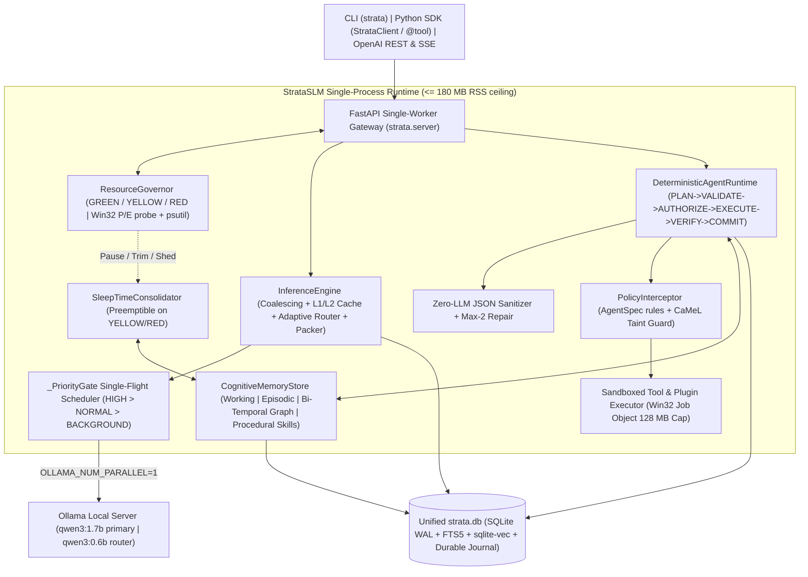

# StrataSLM

[](https://github.com/SiddardhaShayini/StrataSLM/actions/workflows/ci.yml)


> **System Intelligence Over Model Scale** — a featherweight, deterministic local AI runtime, agent state machine, and bi-temporal cognitive memory engine engineered for **8 GB RAM, CPU-only laptops**.

New to StrataSLM? Follow the step-by-step **[Quickstart Guide](QUICKSTART.md)** to go from installation to live cached inference, deterministic agents, memory consolidation, and plugins in minutes.

---

## Why StrataSLM?

Modern AI stacks assume cloud GPUs or heavy multi-container infrastructure (Docker, Redis, PostgreSQL, Qdrant, Neo4j, PyTorch). On a constrained **8 GB RAM CPU-only laptop**, bloated orchestration steals memory needed by the weights and leaves small language models (`0.6B–1.7B`) brittle under real tool-calling workflows.

StrataSLM shifts intelligence from huge model weights into five tightly integrated, single-process Python 3.12 subsystems:

1. **Prefix-Canonical Inference & Dual-Layer Caching (`strata.inference`)**
   - Canonicalizes system prompts, retrieved facts, and sorted tool definitions at leading token positions (`0..k`) so Ollama reuses its KV prefill across turns (**74.4% prefix reuse**, **3.36x faster TTFT** live).
   - **BM25 Tool Pruning (`ToolPruner`)** dynamically selects top-$k$ relevant tools and sorts schemas deterministically (**-69.9% tool prefill overhead**).
   - **2-Tier Cache:** Sub-millisecond normalized exact match (**L1**: in-memory LRU + SQLite) backed by vector semantic matching (**L2**: `sqlite-vec` cosine similarity + pure-Python fallback).
   - **Adaptive Router (`AdaptiveRouter`)** toggles `think=false/true` and routes simple turns vs reasoning/escalation (`qwen3:0.6b` / `qwen3:1.7b`).
   - **Single-Flight Priority Gate & Request Coalescing:** Serializes outbound Ollama generations through priority lanes (`HIGH > NORMAL > BACKGROUND`) and deduplicates concurrent identical requests via `asyncio.Future`.

2. **Deterministic, Injection-Safe Agent Runtime (`strata.agents`)**
   - **6-Phase State Machine:** `PLAN -> VALIDATE -> AUTHORIZE -> EXECUTE -> VERIFY -> COMMIT`.
   - **Zero-LLM JSON Sanitizer + Max-2 Targeted Repair:** Repairs truncated fences, stray text, and schema violations deterministically before failing fast.
   - **Pre-Action Policy & `CaMeL`-Style Taint Tracking (`PolicyInterceptor`):** Tags untrusted external data (`UNTRUSTED_DATA`) and blocks capability escalation to `WRITE`, `EXEC`, or `NETWORK` tools.
   - **Win32 Job Object Sandbox (`sandbox.py`):** Isolates subprocess plugin commands with explicit timeouts, NUL-byte argument rejection, a `128 MB` memory ceiling, and `KILL_ON_JOB_CLOSE`.
   - **Self-Healing Execution & Skill Distillation:** Recovers from minor `READ`/`COMPUTE` argument errors via observation feedback, nudges accidental duplicate tool calls once before halting loops, checkpoints steps idempotently in SQLite (with Saga rollback compensators), and distills verified tool sequences into reusable procedural skills.

3. **CoALA 4-Tier Cognitive Memory (`strata.memory`)**
   - Combines **Working Memory** (bounded session turns), **Episodic Logs**, a **Bi-Temporal Semantic Knowledge Graph** (`valid_from`, `invalid_at`, `superseded_by`, 1-hop `memory_links`), and **Procedural Skill Macros** inside one SQLite WAL database (`strata.db`).
   - **Hybrid RRF Retrieval:** Reciprocal Rank Fusion over `FTS5` (`porter unicode61` + stop-word filtering), `sqlite-vec` vector similarity, and 1-hop graph expansion with historical `as_of` queries and abstention.
   - **In-Process Embeddings (ADR-002):** Zero-weight 128-dim `HashingNgramEmbedder` fallback with automatic upgrade to quantized CPU 384-dim `all-MiniLM-L6-v2` via ONNX Runtime (**4.6x separation margin gain** at **111.25 MB** total RSS — zero Ollama model swapping).
   - **Governor-Preemptible `SleepTimeConsolidator`:** Extracts facts, resolves contradictions, and links entities during idle cycles while yielding immediately if system headroom drops.

4. **3-Stage Resource Governor & Hybrid CPU Telemetry (`strata.governor`)**
   - Probes Windows hybrid P-core / E-core topology (`GetLogicalProcessorInformationEx` via `ctypes`) plus `psutil` fallback, recommends physical core counts (`num_thread=4` on 4P+4E systems), and caches discovered Ollama PIDs for sub-millisecond evaluation.
   - Enforces `GREEN` / `YELLOW` / `RED` hysteresis thresholds to trim caches, pause background consolidation, and shed uncached traffic before OOM.

5. **Single-Process Server, Unified SDK & Plugins (`strata.server`, `strata.sdk`, `strata.plugins`)**
   - Single-worker OpenAI-compatible FastAPI gateway (`/v1/chat/completions` with SSE streaming, `/v1/models`, `/v1/runs`, `/v1/memory/*`, `/health`).
   - Identical **`StrataClient`** interface for embedded in-process mode (`StrataClient.local`) and HTTP client mode (`StrataClient.remote`), plus typed schema extraction via `@tool`.
   - Declarative JSON plugin manifests and MCP tool adapter (`adapt_mcp_tool`) with automatic untrusted taint tagging.

---

## System Architecture



---

## 8 GB RAM Budget & Design Constraints

| Component | Target RSS | Hard Ceiling | Design Strategy |
|---|---:|---:|---|
| OS + Terminal / IDE | ~3.2–3.8 GB | ~4.2 GB | Native Python `3.12` + `uv`; zero Docker/Redis/PyTorch |
| Ollama + `qwen3:1.7b` (`Q4_K_M`, `num_ctx=4096`) | ~1.8–2.1 GB | **2.4 GB** | `OLLAMA_MAX_LOADED_MODELS=1`, `OLLAMA_NUM_PARALLEL=1`, `q8_0` KV cache |
| StrataSLM Runtime + FastAPI | ~40–130 MB | **180 MB** | Single-process async Python with lazy CLI/ML imports |
| In-Process Micro-Embedder (`all-MiniLM-L6-v2` INT8) | ~90–120 MB | **150 MB** | Dynamic batch padding on CPU ONNX Runtime; 128-dim fallback |
| SQLite Unified Store (`WAL` + `FTS5` + `sqlite-vec`) | ~20–60 MB | **100 MB** | Bounded cache page limit (`-8192 KiB`), single file `strata.db` |
| Sandboxed Plugin Subprocess (on-demand) | ~30–80 MB | **128 MB** | Explicit timeout + Win32 Job Object RAM cap & `KILL_ON_JOB_CLOSE` |
| **Total AI Stack** | **~2.0–2.5 GB** | **3.0 GB (`3072 MiB`)** | Leaves safe OS headroom on 8 GB laptops |

---

## Verified Benchmark Snapshot

Measured on Intel Core i5 (8 physical cores / 12 logical — **4 P-cores + 4 E-cores**), Windows 11, Python `3.12.12`, SQLite `3.50.4`, and Ollama `0.40.16` (`qwen3:1.7b`). Full tables and hardware thread sweeps are documented in [`docs/PERFORMANCE_REPORT.md`](docs/PERFORMANCE_REPORT.md).

| Gate / Benchmark | Target | Measured Result | Status |
|---|---|---:|---|
| CLI Cold-Start Latency (`strata --help`) | `< 300 ms` | **`145.37–244.0 ms`** median | PASS |
| FastAPI `create_app()` Boot | `< 800 ms` | **`141.47–186.5 ms`** | PASS |
| Live Prefix-Warm TTFT Speedup (`qwen3:1.7b`) | `>= 2.0x` | **`3.36x`** (`1013.1 ms -> 301.8 ms`) | PASS |
| Cache Hit Latency (`L1_MEM` / `L2_SEMANTIC`) | `< 15 ms` | **`0.011–0.104 ms`** (L1) / **`0.118–1.162 ms`** (L2) | PASS |
| Tool Pruning & Canonical KV Prefix Reuse | `50–80%` / `>= 70%` | **`-69.9%`** prefill / **`74.4%`** reuse | PASS |
| Agent JSON Schema Repair & Policy Taint Guard | `>= 95%` / `100%` | **`100.0%`** / **`100.0%`** | PASS |
| Agent `pass^3` vs Naïve ReAct Baseline | `> +20%` | **`3/3` vs `0/3` (`+100.0%`)** + skill distilled | PASS |
| Memory `Recall@5` & Query Latency | Beat baselines / `< 30 ms` | **`1.00`** (`vec=0.88`, `win=0.00`) / **`0.20–0.22 ms`** | PASS |
| Quantized ONNX MiniLM vs Hashing Margin (RSS) | Margin gain, `<= 180 MB` | **`0.4784` vs `0.1046`** (`1.00` Mem@1, **`111.25 MB`** RSS) | PASS |
| Peak Total AI Stack RSS (`Strata + qwen3:1.7b`) | `<= 2560 MB` / `<= 3072 MB` | **`1920.04 MB`** peak live / **`92.53 MB`** idle (`ops_helper`) | PASS |
| Concurrency & OOM Stress | Zero OOM | **`7/7` coalesced**, `HIGH > BG`, `RED` shed OK | PASS |

---

## HTTP API & Python SDK At A Glance

| Component | Highlights |
|---|---|
| **HTTP Endpoints** (`strata serve`) | `GET /health`, `GET /v1/models`, `POST /v1/chat/completions` (OpenAI-compatible + SSE `stream: true`), `POST /v1/runs`, `GET /v1/runs/{run_id}`, `POST /v1/memory/episodes`, `POST /v1/memory/recall`, `POST /v1/memory/consolidate` |
| **Python SDK** (`strata.sdk`) | `StrataClient.local(...)`, `StrataClient.remote(base_url)`, `@tool(tags=..., capability=...)`, `chat()`, `run_agent()`, `remember()`, `recall()`, `consolidate()`, `health()` |
| **CLI Commands** (`strata`) | `doctor`, `run`, `serve`, `profile`, `models fetch-minilm`, `bench {threads, cold-start, eval, inference, embedders}`, `--version` |

```python
import asyncio
from strata.agents.policy import Capability
from strata.sdk import StrataClient, tool

@tool(tags=("math",), capability=Capability.COMPUTE)
def multiply(a: int, b: int) -> int:
    """Multiply two integers."""
    return a * b

async def main() -> None:
    async with StrataClient.local(tools=[multiply]) as client:
        await client.remember("demo", "user", "My name is Dev. I live in Bengaluru.")
        await client.consolidate()
        res = await client.run_agent("Multiply 6 and 7")
        print(res["final_answer"])

asyncio.run(main())
```

---

## Project Layout

```text
StrataSLM/
├── src/strata/
│   ├── cli.py                   # Lazy-import CLI (< 300 ms startup)
│   ├── config.py                # Env configuration & 8 GB budget thresholds
│   ├── governor/                # Win32 P/E-core probe + 3-stage ResourceGovernor
│   ├── inference/               # Priority gate, coalescing, tool pruner, prompt packer, L1/L2 cache, router
│   ├── agents/                  # 6-phase FSM, JSON repair, PolicyInterceptor + CaMeL taint, Win32 sandbox, journal
│   ├── memory/                  # CoALA store (SQLite WAL+FTS5+vec), ONNX/hashing embedders, sleep consolidator
│   ├── plugins/                 # JSON manifest plugin loader & MCP tool adapter
│   ├── sdk/                     # Unified StrataClient (local / remote) & @tool decorator
│   ├── server/                  # Single-worker FastAPI gateway & SSE streaming
│   ├── storage/                 # Unified SQLite schema (v1–v4 migrations) & sqlite-vec loader
│   └── perf/                    # Thread sweep, cold-start, eval harness, embedder A/B, live bench, cProfile
├── examples/                    # workspace_analyst.py, ops_helper.py, memory_companion.py
├── tests/                       # 12 unit/integration/eval test modules (pytest + pytest-asyncio)
├── docs/                        # ARCHITECTURE.md & PERFORMANCE_REPORT.md
├── benchmarks/results/          # Gitignored local JSON telemetry outputs
├── QUICKSTART.md                # Full step-by-step setup & usage walkthrough
├── PLAN.md                      # Master engineering plan & ADRs 001–008
└── PROJECT_MEMORY.md            # Persistent architectural log & empirical lessons
```

---

## Configuration Environment Variables

| Variable | Default | Purpose |
|---|---|---|
| `OLLAMA_HOST` | `http://127.0.0.1:11434` | Local Ollama base URL (`0.0.0.0` normalized to loopback) |
| `OLLAMA_MAX_LOADED_MODELS` | *(recommend `1`)* | Prevents Ollama from keeping multiple models resident in 8 GB RAM |
| `OLLAMA_NUM_PARALLEL` | *(recommend `1`)* | Avoids duplicate KV cache allocations |
| `OLLAMA_KV_CACHE_TYPE` | *(recommend `q8_0`)* | Quantizes KV cache memory (~50% lower KV footprint) |
| `OLLAMA_FLASH_ATTENTION` | *(recommend `1`)* | Required with `q8_0` KV cache quantization |
| `STRATA_DATA_DIR` | `.strata` | Stores `strata.db` and optional `models/all-MiniLM-L6-v2` |
| `STRATA_PRIMARY_MODEL` | `qwen3:1.7b` | Primary reasoning & tool-calling model |
| `STRATA_ROUTER_MODEL` | `qwen3:0.6b` | Optional fast router model for `--fast` mode |
| `STRATA_NUM_CTX` | `4096` | Bounded context window ceiling |
| `STRATA_NUM_THREAD` | `4` | CPU threads (pinned to physical P-cores by default) |

---

## Documentation

- **[QUICKSTART.md](QUICKSTART.md)** — Complete step-by-step installation, Ollama tuning, CLI, API, SDK, plugins, and testing guide.
- **[docs/ARCHITECTURE.md](docs/ARCHITECTURE.md)** — Subsystem topology, data flows, and runtime guarantees.
- **[docs/PERFORMANCE_REPORT.md](docs/PERFORMANCE_REPORT.md)** — Live CPU thread sweeps, TTFT/L1/L2 latency, `cProfile` hotspots, and ADR-002 ONNX A/B benchmarks.
- **[PLAN.md](PLAN.md)** — Research survey, 8 GB hardware budget, ADRs, and deliverable checklist.
- **[PROJECT_MEMORY.md](PROJECT_MEMORY.md)** — Chronological implementation ledger and debugging lessons.
