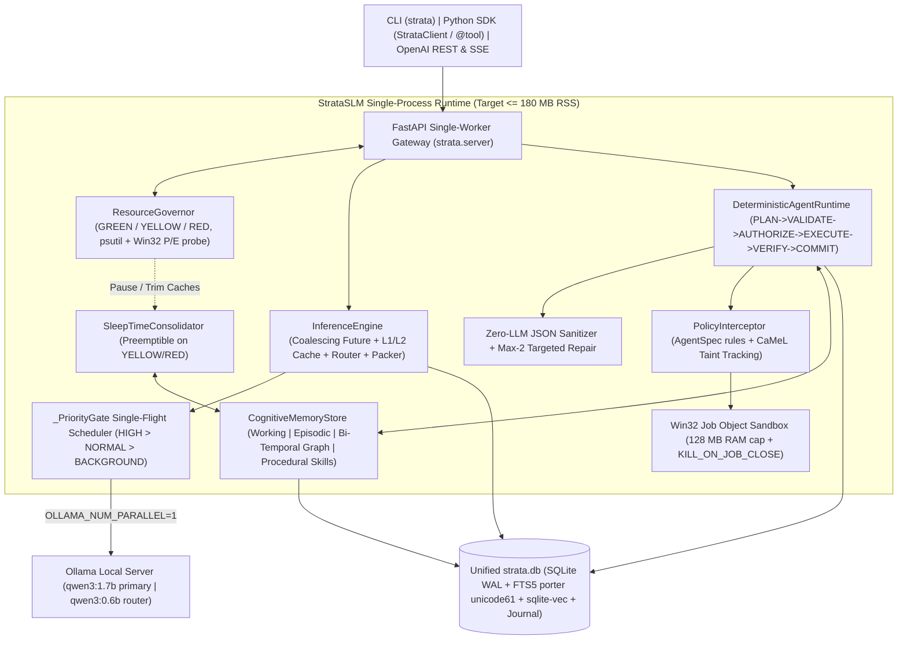

# StrataSLM Architecture

> **Core Thesis:** On an 8 GB RAM, CPU-only laptop, system architecture delivers what model weights cannot afford: fast prefix reuse, deterministic reliability, capability-safe sandboxing, and bi-temporal cognitive memory inside a single lightweight Python 3.12 process.

---

## 1. System Topology

---

## 2. Module Map (`src/strata/`)

| Subsystem | Files | Responsibilities & Design |
|---|---|---|
| **Config & CLI** | `config.py`, `cli.py` | Lazy-import CLI keeping startup `< 300 ms`; normalizes `OLLAMA_HOST`; exposes `doctor`, `run`, `serve`, `profile`, `bench {threads,cold-start,eval,inference}`. |
| **Resource Governor** | `governor/{hardware,resource_governor}.py` | Win32 `GetLogicalProcessorInformationEx` hybrid P/E-core topology probe + `psutil` RSS telemetry; 3-stage hysteresis (`GREEN`, `YELLOW`, `RED`) that pauses background consolidation, trims caches, and sheds uncached requests under OOM pressure. |
| **Inference Engine** | `inference/{client,tool_pruner,prompt,cache,router,engine}.py` | Priority single-flight gate (`RequestPriority`: `HIGH`, `NORMAL`, `BACKGROUND`), concurrent identical request coalescing (`asyncio.Future`), BM25 top-$k$ alphabetical tool pruning, canonical prefix-first `ContextBudget` prompt packer, `L1ExactCache` (`L1_MEM` + `L1_SQLITE`), `L2SemanticCache` (`sqlite-vec` cosine + Python fallback), and adaptive `think` router. |
| **Reliable Agents** | `agents/{schema,policy,journal,sandbox,runtime}.py` | Zero-LLM JSON sanitizer + max-2 Pydantic repair loop; pre-action policy interceptor & `CaMeL`-style untrusted taint tracking; Win32 Job Object subprocess isolation; SQLite step journal (`idempotency_key` replay + Saga compensators); recoverable `READ`/`COMPUTE` error feedback; automatic procedural skill distillation (`save_skill` / `match_skill`). |
| **Cognitive Memory** | `memory/{embedder,store,consolidator}.py` | Pluggable `HashingNgramEmbedder` (128-dim zero-dep) or quantized `OnnxMiniLMEmbedder` (384-dim lazy-loaded CPU ONNX); CoALA 4-tier store in `strata.db`; Hybrid RRF combining `FTS5 porter unicode61`, vector similarity, and 1-hop `memory_links` expansion with bi-temporal `valid_from`/`invalid_at` contradiction handling and abstention; governor-preemptible sleep-time consolidation. |
| **Infrastructure & Perf** | `plugins/loader.py`, `sdk/client.py`, `server/app.py`, `perf/{bench,evals}.py`, `storage/db.py` | Manifest & sandboxed MCP subprocess plugin loader (`returns_untrusted=True`), unified `StrataClient` (`local`/`remote`) + `@tool` schema extractor, OpenAI-compatible FastAPI gateway, and regression/cProfile suites. |

---

## 3. Core Runtime Guarantees (8 GB Hardware Envelope)

1. **Single-Process Modular Monolith (ADR-003, ADR-004):** All persistence (L1/L2 caches, agent checkpoints/steps, CoALA memory tiers, FTS5 indexes, and `sqlite-vec` vectors) lives inside one bounded WAL SQLite file (`strata.db`, 8 MiB page cache cap) — zero external containers or brokers.
2. **Single-Flight Multiplexing Without Model Swapping (ADR-001, ADR-002):** `OllamaClient` serializes outbound generation through `_PriorityGate`, while `InferenceEngine` coalesces identical concurrent prompts and runs text embeddings strictly in-process (`HashingNgramEmbedder` or CPU quantized ONNX MiniLM).
3. **Deterministic Guardrails Over Model Scale (ADR-006):** Small models never reach privileged tools with tainted data or malformed JSON; invalid structures go through deterministic cleanup + bounded targeted repair, while repeatable successful workflows distill into procedural skill macros.
